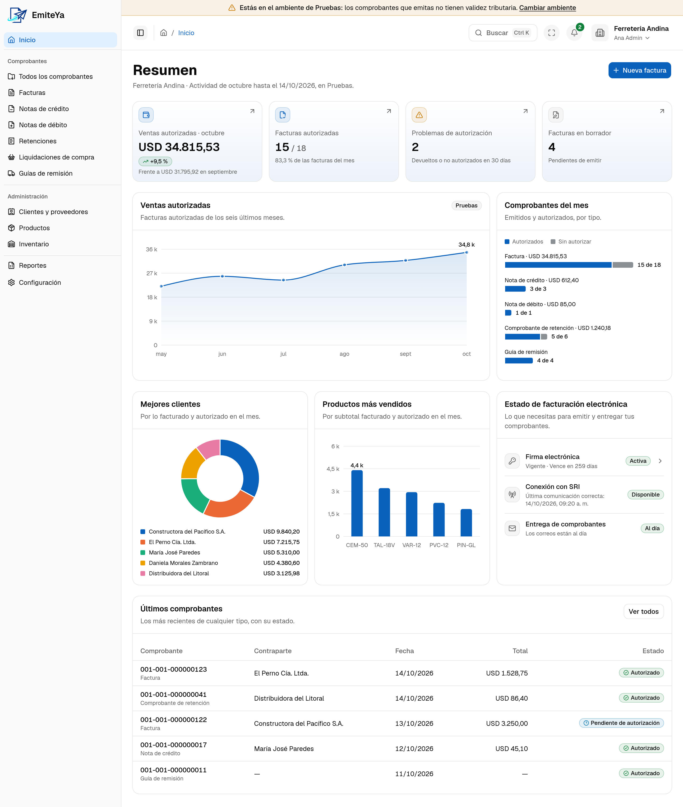

# EmiteYa

**Facturador electrónico open source y self-hosted para Ecuador.** Emite, conserva, envía por
correo y exporta los seis comprobantes electrónicos del SRI en el esquema off-line, desde tu propio
servidor. No es un ERP, un POS ni un sistema contable.



<sub>Captura con datos de demostración de una empresa ficticia.</sub>

## Contenido

- [Qué hace](#qué-hace)
- [Estado](#estado)
- [Inicio rápido](#inicio-rápido)
- [Despliegue en producción](#despliegue-en-producción)
- [Verificación](#verificación)
- [Documentación](#documentación)
- [Créditos](#créditos)
- [Contribuir y seguridad](#contribuir-y-seguridad)
- [Licencia](#licencia)

## Qué hace

- **Los seis comprobantes del SRI:** factura, nota de crédito, nota de débito, comprobante de
  retención, guía de remisión y liquidación de compra, con borradores editables, clave de acceso,
  XML validado contra el XSD oficial y firma electrónica XAdES-BES.
- **Transmisión al SRI** con recepción y autorización asíncronas, reconciliación de resultados
  inciertos y detección de anulaciones.
- **Entrega por correo** del XML autorizado y el RIDE en PDF, con el servidor SMTP de cada
  empresa, reintentos y reenvío.
- **Empresa y catálogos:** establecimientos, puntos de emisión, numeración auditada, firma
  electrónica custodiada con cifrado, catálogos fiscales oficiales, clientes y proveedores,
  productos e inventario opcional.
- **Operación diaria:** tablero de Inicio, bandeja de todos los comprobantes, reportes en XLSX,
  portabilidad completa de los datos, usuarios con roles y auditoría.

El detalle de cada versión está en [`CHANGELOG.md`](CHANGELOG.md).

## Estado

- **Primera versión pública** completa.
- **Certificada en el ambiente de Pruebas del SRI** el 2026-10-11, con los siete comprobantes de
  la matriz autorizados ([`docs/quality/sri-certification.md`](docs/quality/sri-certification.md)).
- **La transmisión al SRI viene apagada** (`SRI_TRANSMISSION_ENABLED=0`). Habilitar Producción es
  una decisión de cada instalación, con su propia firma electrónica y la lista «Fuera de este
  runbook: go-live» de ese documento.
- **Alcance de v1:** uso propio o suministro no comercial
  ([`docs/product/overview.md`](docs/product/overview.md)).

## Inicio rápido

### Requisitos

- Node.js 24 LTS (`.node-version` indica la versión probada).
- Corepack, incluido con Node.js. El proyecto usa pnpm con la versión fijada en `package.json`;
  no uses npm ni yarn.
- Docker con Docker Compose, para PostgreSQL.

### Instalar y levantar

```bash
corepack enable
corepack pnpm install

# PostgreSQL 17 en Docker: facturador_dev (desarrollo) y facturador_test (pruebas)
docker compose up -d --wait
cp backend/.env.example backend/.env
corepack pnpm --filter @facturador/backend db:migrate:deploy

corepack pnpm dev
```

El primer arranque crea la empresa y el administrador inicial con `INITIAL_USER_EMAIL` e
`INITIAL_USER_PASSWORD` de `backend/.env`; con ellos inicias sesión en http://localhost:3000.

| Servicio | URL |
| --- | --- |
| Interfaz (Next.js) | http://localhost:3000 |
| API, a través de la interfaz (mismo origen) | http://localhost:3000/api/v1/… |
| Backend directo | http://localhost:4000 |
| Salud y métricas (operacionales; no son API pública) | http://localhost:4000/health/live, /health/ready, /metrics |

### Notas para desarrollo

- `POSTGRES_PORT` cambia el puerto local de PostgreSQL (por defecto 5432); ajusta entonces las
  URLs de `backend/.env`. `db:status` informa el estado de las migraciones.
- Para crear una migración a partir de `backend/prisma/schema.prisma`:
  `corepack pnpm --filter @facturador/backend db:migrate:dev --name <nombre>`.
- El cliente de Prisma se genera en `backend/src/generated/prisma/` (no versionado) al instalar y
  con `db:generate`. Para regenerar los modelos de Better Auth tras cambiar sus plugins o su
  versión: `corepack pnpm --filter @facturador/backend db:auth-schema`
  (ver `docs/architecture/database.md`).
- La interfaz reenvía `/api/*` al backend; cambia el destino con `API_INTERNAL_URL` en
  `frontend/.env.local` (ver `frontend/.env.example`). La descarga del paquete de portabilidad
  tiene su propia ruta del mismo origen, que lee la misma variable.
- El backend corre con el soporte nativo de TypeScript de Node 24 y se reinicia al guardar. Sigue
  las restricciones de ADR 0016: sin `enum`, `namespace` con contenido, propiedades de parámetro ni
  alias de `paths`, e imports relativos con extensión `.ts`.
- **Versiones:** las dependencias van en versión exacta y el lockfile se versiona. Prisma
  permanece en la major 7: ejecuta sus binarios solo desde el repositorio
  (`corepack pnpm exec prisma …` o los scripts `db:*`), nunca con `npx prisma` ni
  `pnpm dlx prisma` sin versión, que descargarían la última publicada.
- **Comandos destructivos de Prisma** (`prisma migrate reset`, `prisma db push --accept-data-loss`
  y equivalentes) borran datos. Ningún script del proyecto los usa; solo una persona los ejecuta,
  de forma explícita, y un agente nunca lo hace sin el consentimiento expreso del usuario.
- Recuperación de emergencia de un administrador: `docs/architecture/deployment.md`.

## Despliegue en producción

La topología de referencia es `deploy/compose.yaml`: nginx como único servicio público (TLS en
443 y redirección en 80), y la interfaz, la API y PostgreSQL 17 en una red interna sin salida a
Internet. El detalle está en `docs/architecture/deployment.md` ("Topología de referencia" y
"Respaldo y restauración") y en ADR 0027.

**Instalación**, en un servidor Linux con Docker y Docker Compose:

1. Crea fuera del repositorio el archivo de entorno y el directorio de secretos que describe
   `deploy/production.env.example`: la contraseña de PostgreSQL, la clave maestra de la custodia
   (32 bytes en base64, legible por el UID 1000), el certificado TLS válido con su clave, y
   `DATABASE_URL`, `BETTER_AUTH_SECRET` y el administrador inicial.
2. Exporta las variables de Compose (`EMITEYA_ENV_FILE`, `EMITEYA_SECRETS_DIR`, `PUBLIC_ORIGIN` y,
   si la subred choca con la del host, `APP_SUBNET`, `APP_IP_RANGE` y `PROXY_APP_IP` juntas).
3. Construye las imágenes y arranca:

   ```bash
   docker compose -f deploy/compose.yaml build
   docker compose -f deploy/compose.yaml up -d
   ```

   PostgreSQL arranca, las migraciones se aplican una vez y solo entonces arranca la API. La
   instalación está lista cuando `/health/ready` responde 200 por la red interna:

   ```bash
   docker compose -f deploy/compose.yaml exec backend \
     node -e "fetch('http://127.0.0.1:4000/health/ready').then((r) => process.exit(r.ok ? 0 : 1))"
   ```

4. Inicia sesión con el administrador inicial y retira después `INITIAL_USER_PASSWORD` del archivo
   de entorno.

La transmisión al SRI nace apagada (`SRI_TRANSMISSION_ENABLED=0`) y la red de la aplicación no
tiene salida. El uso real del SRI exige dos pasos deliberados del dueño, documentados en
`docs/architecture/deployment.md`.

**Actualización:** respalda la base, actualiza el repositorio a la versión nueva y repite el paso 3
(`build` y `up -d`): Compose aplica las migraciones antes de recrear la API y la interfaz, y una
migración fallida deja la API sin arrancar.

**Respaldo**, con las mismas variables de Compose:

```bash
deploy/backup.sh /ruta/de/respaldos
```

Deja un volcado `pg_dump -Fc` de PostgreSQL 17 y su `.sha256`. Contiene datos fiscales y del
negocio: cífralo y guárdalo fuera del servidor bajo tu control. La clave maestra de la custodia no
va en el volcado y se respalda aparte: sin ella, los certificados custodiados no se recuperan.

**Restauración**, con la aplicación detenida y una base vacía:

```bash
docker compose -f deploy/compose.yaml up -d postgres
deploy/restore.sh /ruta/de/respaldos/emiteya-<fecha>.dump
docker compose -f deploy/compose.yaml up -d
```

`restore.sh` comprueba la suma antes de tocar nada y se niega a escribir sobre una base con datos;
su opción `--replace-existing` es destructiva.

## Verificación

```bash
corepack pnpm verify
```

Encadena formato, versiones fijadas, generación del cliente de Prisma, lint, typecheck, pruebas
(las de integración exigen PostgreSQL en marcha), OpenAPI, el arranque del backend en modo
desarrollo, el build, la política de seguridad del navegador y los artefactos del SRI. Si
PostgreSQL no está disponible, las pruebas de integración fallan con la indicación de levantarlo.

Los ensayos del despliegue (`corepack pnpm deployment:context`, `deployment:topology` y
`deployment:recovery`) necesitan Docker y corren aparte, también en el workflow `deployment` de la
CI ([`docs/quality/testing.md`](docs/quality/testing.md)).

## Documentación

| Tema | Dónde |
| --- | --- |
| Producto, alcance y vocabulario | [`docs/product/`](docs/product/) |
| Arquitectura | [`ARCHITECTURE.md`](ARCHITECTURE.md) y [`docs/architecture/`](docs/architecture/) |
| Decisiones de arquitectura (ADR) | [`docs/architecture/adr/`](docs/architecture/adr/) |
| Despliegue, respaldo y recuperación | [`docs/architecture/deployment.md`](docs/architecture/deployment.md) |
| Seguridad y control de acceso | [`docs/security/`](docs/security/) |
| Calidad, pruebas y certificación con el SRI | [`docs/quality/`](docs/quality/) |
| Comportamiento vigente (especificaciones) | [`openspec/specs/`](openspec/specs/) |

## Créditos

La integración con el SRI se apoya en dos librerías open source:

- **[facturacion-electronica-ec](https://github.com/cuymo/facturacion-electronica-ec)** (MIT,
  versión 1.0.1): librería TypeScript para la emisión de comprobantes electrónicos del SRI
  Ecuador. EmiteYa la usa como base del motor SRI para construir el XML de los seis
  comprobantes, generar la clave de acceso y validar los datos, detrás de puertos propios
  ([ADR 0018](docs/architecture/adr/0018-motor-sri-facturacion-electronica-ec.md)).
- **[ec-sri-invoice-signer](https://github.com/bryancalisto/ec-sri-invoice-signer)** (MIT,
  versión 1.8.2), de Bryan Calisto: la firma XAdES-BES de los comprobantes.

También se apoya en Next.js, React, Express, Prisma, PostgreSQL, Better Auth, pdfmake (el RIDE),
xmllint-wasm (la validación XSD) y driver.js (el recorrido de bienvenida), entre otras. Las
versiones están en [`docs/architecture/stack.md`](docs/architecture/stack.md), y los avisos de
los recursos de terceros de la interfaz, en
[`frontend/THIRD_PARTY_NOTICES.md`](frontend/THIRD_PARTY_NOTICES.md).

## Contribuir y seguridad

- Cómo contribuir: [`CONTRIBUTING.md`](CONTRIBUTING.md). Conducta:
  [`CODE_OF_CONDUCT.md`](CODE_OF_CONDUCT.md).
- Vulnerabilidades: repórtalas en privado como indica [`SECURITY.md`](SECURITY.md), nunca en un
  issue público.

## Licencia

EmiteYa se publica bajo la [GNU Affero General Public License v3.0](LICENSE) (`AGPL-3.0-only`).
Puedes usarlo, estudiarlo, modificarlo y compartirlo. Si lo ofreces a otras personas como servicio
en red con cambios, debes publicar el código de esos cambios bajo la misma licencia.

Copyright (C) 2026 los colaboradores de EmiteYa.
